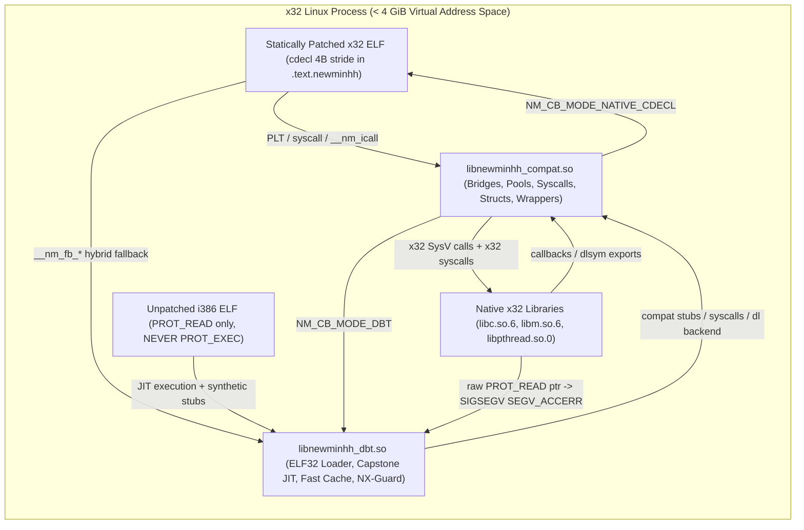
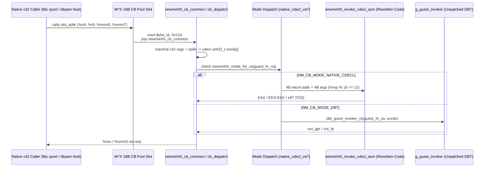
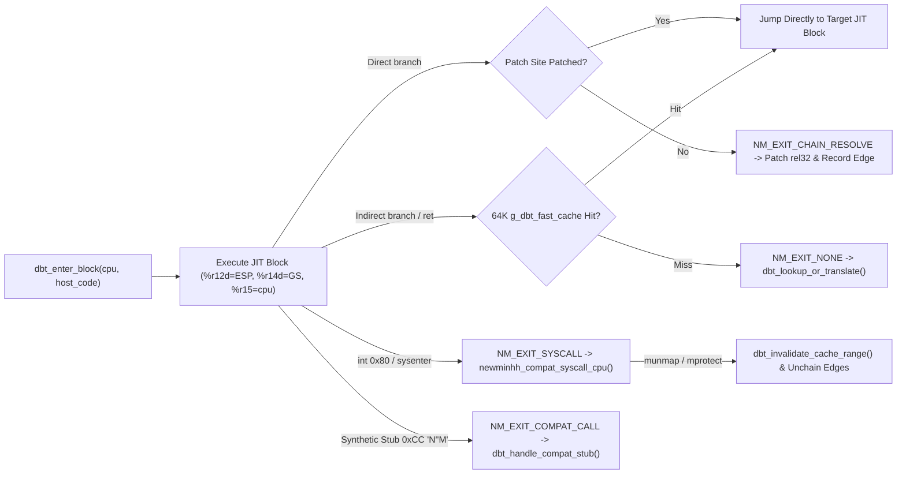
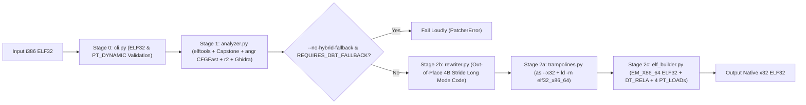

# newminhh Architecture Reference

This document details the internal design of all four core subsystems of `newminhh`:

1. [`newminhh/common`](https://github.com/newminhh/common) (`src/common/`) — Shared ABI contract, `newminhh_cpu_t` offsets, struct layouts, and logging
2. [`newminhh/compat`](https://github.com/newminhh/compat) (`src/compat/`) — `libnewminhh_compat.so` runtime bridges, trampoline pools, syscalls, struct repacking, dynamic linking, and libc/libm/pthread wrappers
3. [`newminhh/dbt`](https://github.com/newminhh/dbt) (`src/dbt/`) — `libnewminhh_dbt.so` and `newminhh-run` in-process Capstone JIT translator, ELF32 loader, edge chaining, fast cache, and `SIGSEGV` NX-guard callbacks
4. [`newminhh/patcher`](https://github.com/newminhh/patcher) (`src/patcher/`) — `newminhh-patch` / `re_patcher` multi-tool static analyzer, 4-byte stack-stride Long Mode rewriter, x32 GAS trampoline generator, and `EM_X86_64` ELF32 builder

---

## 1. System-Wide Architecture & ABI Divergence

`newminhh` bridges three distinct execution ABIs inside a single x32 (`EM_X86_64`, `ELFCLASS32`, `__ILP32__`) Linux process whose kernel has `ia32_emulation=0`:

| Property | i386 SysV (`EM_386`) | Rewritten cdecl-Stride (`EM_X86_64`) | Native x32 SysV (`EM_X86_64`) |
| :--- | :--- | :--- | :--- |
| CPU Mode | 32-bit Protected / Compatibility | 64-bit Long Mode | 64-bit Long Mode |
| Pointer / `long` Width | 32-bit | 32-bit (`0x67` addr32 prefix) | 32-bit (ILP32, `< 4 GiB`) |
| Return Address on Stack | 4 bytes (`call` pushes 4B) | 4 bytes (`leal .Lret(%rip)` + `lea -4(%rsp)`) | 8 bytes (`callq` pushes 8B) |
| Argument Passing | Stack only, 4-byte slot stride | Stack only, 4-byte slot stride on `%rsp` | `%rdi, %rsi, %rdx, %rcx, %r8, %r9` + `%xmm0..%xmm7`, 8-byte spills |
| 64-bit Integer Return | `EDX:EAX` | `EDX:EAX` | `%rax` (full 64-bit) |
| Floating-Point Return | x87 `ST(0)` | x87 `ST(0)` | `%xmm0` |
| Callee-Saved GPRs | `EBX, ESI, EDI, EBP, ESP` | `EBX, ESI, EDI, EBP, RSP` | `RBX, RBP, R12, R13, R14, R15, RSP` |
| Variadic Float Count | Not used | Not used | `%al` = number of XMM args |
| TLS Segment | `%gs` via `set_thread_area` (GDT 6–8) | `%gs` via `arch_prctl(ARCH_SET_GS)` | `%fs` (native x32 libc) / `%gs` (guest) |
| Syscall Mechanism | `int $0x80` / `sysenter`, i386 numbers | Call to `__nm_syscall_tramp` | `syscall`, `__X32_SYSCALL_BIT` (`0x40000000`) |

---

## 2. Common ABI Contract (`src/common/`)

`newminhh/common` consists of three header files included by C translation units and GAS assembly files (guarded by `#ifndef __ASSEMBLER__`):
- `newminhh_cstd.h` — Standard GNU C23 baseline (`__STDC_VERSION__ >= 202311L`), nullability, and cross-compiler safety macros.
- `newminhh_abi.h` — Virtual CPU context, ABI offsets, struct repacking definitions, calling conventions, and symbol tables.
- `newminhh_log.h` — C23 `__VA_OPT__(,)` structured logging macros (`NM_LOG_ERROR`, `NM_LOG_WARN`, `NM_LOG_INFO`, `NM_LOG_DEBUG`).

### 2.1 Virtual CPU Context (`newminhh_cpu_t`)

Defined in `src/common/newminhh_abi.h`, `newminhh_cpu_t` is 16-byte aligned (`alignas(16)`) and exactly **592 bytes** (`NM_CPU_SIZE = 592`), verified at compile time with standard C23 `static_assert`:

| Byte Offset | Macro Constant | Field | Width | Purpose |
| :--- | :--- | :--- | :--- | :--- |
| `0..28` | `NM_CPU_OFF_GPR` / `EAX..EDI` | `uint32_t gpr[8]` | 32B | `EAX(0)=0`, `ECX(1)=4`, `EDX(2)=8`, `EBX(3)=12`, `ESP(4)=16`, `EBP(5)=20`, `ESI(6)=24`, `EDI(7)=28` |
| `32` | `NM_CPU_OFF_EIP` | `uint32_t eip` | 4B | Next guest 32-bit instruction pointer |
| `36` | `NM_CPU_OFF_EFLAGS` | `uint32_t eflags` | 4B | Guest x86 flags register (initialized to `0x202`) |
| `40` | `NM_CPU_OFF_GS_BASE` | `uint32_t gs_base` | 4B | Active guest TLS `GS` base linear address |
| `44` | `NM_CPU_OFF_FS_BASE` | `uint32_t fs_base` | 4B | Guest `FS` base (reserved) |
| `48..59` | `NM_CPU_OFF_TLS_BASES` | `uint32_t tls_bases[3]` | 12B | Virtualized GDT slots `6`, `7`, and `8` (`set_thread_area`) |
| `60` | `NM_CPU_OFF_EXIT_REASON` | `uint32_t exit_reason` | 4B | Reason JIT block returned to `dbt_run_cpu_loop` |
| `64` | `NM_CPU_OFF_EXIT_ARG` | `uint32_t exit_arg` | 4B | Context argument (`stub_id` or `patch_site_va`) |
| `68..79` | *(padding)* | `uint32_t _pad[3]` | 12B | Aligns `fxsave_area` to 16 bytes |
| `80..591` | `NM_CPU_OFF_FXSAVE` | `uint8_t fxsave_area[512]` | 512B | 16-byte aligned x87/MMX/SSE `fxsave`/`fxrstor` image |

Exit reason constants:
- `NM_EXIT_NONE (0)` — Indirect branch cache miss; dispatch `cpu->eip`
- `NM_EXIT_SYSCALL (1)` — Guest executed `int $0x80` or `sysenter`
- `NM_EXIT_COMPAT_CALL (2)` — Guest jumped to synthetic stub ID in `exit_arg`
- `NM_EXIT_HLT (3)` — Guest halt
- `NM_EXIT_UNSUPPORTED (4)` — Forbidden/undecodable opcode at `cpu->eip`
- `NM_EXIT_RET_TO_HOST (5)` — Return to host
- `NM_EXIT_CHAIN_RESOLVE (16)` *(in `dbt_internal.h`)* — Unresolved direct branch edge at `exit_arg`

### 2.2 Error Codes, Signatures & Hooks

- **Error codes (`nm_err_t`)**: `NM_OK (0)`, `NM_ERR_ELF (-1)`, `NM_ERR_INSN (-2)`, `NM_ERR_SYSCALL (-3)`, `NM_ERR_DLSYM (-4)`, `NM_ERR_ABI (-5)`.
- **Signature descriptors (`nm_fn_sig_t`, 20 bytes)**: `ret_kind` (1B), `nargs` (1B, max `NM_MAX_SIG_ARGS = 16`), `is_variadic` (1B), `_reserved` (1B), `arg_kinds[16]`.
  - Kind values: `NONE/VOID(0)`, `I32(1)`, `U32(2)`, `PTR(3)`, `I64(4)`, `U64(5)`, `F32(6)`, `F64(7)`.
- **Symbol entry (`nm_sym_entry_t`)**: `{ name, wrapper_fn, sig, flags }`, where `flags` uses:
  - `NM_SYM_FLAG_DATA (1u << 0)` — Data export (e.g., `stdin`, `environ`)
  - `NM_SYM_FLAG_VARIADIC (1u << 1)` — Variadic function (`open`, `fcntl`, `ioctl`, `printf`, etc.)
  - `NM_SYM_FLAG_CDECL_DIRECT (1u << 2)` — Wrapper directly consumes `const uint32_t *cdecl_args` (`compat_*_cdecl`)
- **Callback & dlopen flags**: `NM_CB_MODE_NATIVE_CDECL (0)`, `NM_CB_MODE_DBT (1)`, `NM_CB_FLAG_UNTYPED (1u << 0)`, `NM_RTLD_CDECL (0x10000)`.
- **Structured logging (`newminhh_log.h`)**: Uses standard C23 `__VA_OPT__(,)` to eliminate legacy GNU zero-variadic comma pasting warnings. `NM_LOG_ERROR` and `NM_LOG_WARN` always print `[newminhh:<mod>] ERROR|WARN: ...` to `stderr`; `NM_LOG_INFO` emits only when `NEWMINHH_DEBUG` is set to a non-empty, non-`"0"` value.

### 2.3 C23 Conformance & Cross-Compiler Portability (`newminhh_cstd.h`)

All C translation units enforce ISO C23 (`__STDC_VERSION__ >= 202311L`) with zero legacy shims:
- **Language Keywords**: `alignas`, `alignof`, `static_assert`, `thread_local`, `bool`, `true`, `false`, `nullptr`, `constexpr`.
- **Standard Headers**: `<stdckdint.h>` (`ckd_add`, `ckd_sub`, `ckd_mul`), `<stdbit.h>` (`stdc_has_single_bit`, `stdc_bit_ceil`), `<stdatomic.h>` (`_Atomic` and `atomic_*_explicit`).
- **Guarded Extensions**:
  - Clang nullability qualifiers (`NM_NONNULL_PTR` -> `_Nonnull`, `NM_NULLABLE_PTR` -> `_Nullable`) enabling `-Wnullability-completeness`.
  - Non-escaping pointers (`NM_NOESCAPE` -> `[[clang::noescape]]`).
  - Clang compile-time diagnostics (`NM_DIAGNOSE_IF`).
  - Dual GCC/Clang flexible-array bounds safety (`NM_COUNTED_BY`).
  - Type-safe array element counts (`NM_COUNTOF`).
  - Strict ISO C function pointer <-> `void *` casting without diagnostics (`NM_FN_TO_VOIDP`, `NM_VOIDP_TO_FN`).

---

## 3. Compatibility Runtime (`src/compat/` -> `libnewminhh_compat.so`)

`libnewminhh_compat.so` is compiled as an x32 PIC shared library linked against `-ldl -lpthread -lm` with version script `compat_syms.map` exporting only `newminhh_*` and `compat_*` under `NEWMINHH_COMPAT_1.0`.

### 3.1 Assembly Calling Convention Bridges (`compat_asm.S`)

`compat_asm.S` provides five assembly primitives that translate between 4-byte-stride i386 cdecl frames and native x32 SysV frames:

1. **`newminhh_call_x32_sig(target_x32_fn, sig, i386_cdecl_args, out_fp_bits)`** *(Outgoing: cdecl -> x32)*
   - Allocates a 248-byte local stack buffer holding 6 GPR slots (`[%rsp+0..47]`), 8 XMM slots (`[%rsp+48..111]`), and up to 16 stack-spill 8-byte slots (`[%rsp+112..239]`).
   - Iterates `0..sig->nargs-1`, reading from `i386_cdecl_args`:
     - `NM_ARG_I32`: 4-byte read sign-extended (`movslq`) into 64-bit GPR slot (`%rdi, %rsi, %rdx, %rcx, %r8, %r9`) or spill.
     - `NM_ARG_U32`, `NM_ARG_PTR`: 4-byte read zero-extended (`movl`) into GPR slot or spill.
     - `NM_ARG_I64`, `NM_ARG_U64`: 8-byte read (`movq`) into GPR slot or spill.
     - `NM_ARG_F32`: 4-byte read (`movl`) into XMM slot (`%xmm0..%xmm7`) or spill.
     - `NM_ARG_F64`: 8-byte read (`movq`) into XMM slot or spill.
   - Rounds spill slot count up to an even number (`(n + 1) & -2`) to preserve 16-byte stack alignment across `call *%r12`, sets `%eax = xmm_count` for SysV variadics, invokes `target_x32_fn`, and writes `%xmm0` to `*out_fp_bits` (`movss` / `movsd`) when `ret_kind` is `F32`/`F64`.

2. **`newminhh_call_x32_cdecl(target_x32_fn, sig, i386_cdecl_args)`** *(Outgoing: cdecl -> x32 -> cdecl return)*
   - Wraps `newminhh_call_x32_sig` and converts the return value back to i386 cdecl registers:
     - `NM_RET_I64` / `NM_RET_U64`: splits `%rax` into `%edx` (high 32) and `%eax` (low 32).
     - `NM_RET_F32` / `NM_RET_F64`: loads `out_fp_bits` onto the x87 FPU stack (`flds` / `fldl`) so `ST(0)` holds the return value.
     - `NM_RET_I32` / `NM_RET_U32` / `NM_RET_PTR`: zero-extends `%eax`.

3. **`newminhh_out_common`** *(Outgoing 16B trampoline common entry)*
   - Entered from an allocated 16-byte pool slot (`movl $slot_id, %r11d; jmp newminhh_out_common`) by a cdecl-stride caller whose stack holds `[%rsp+0]` = 4-byte return address and `[%rsp+4...]` = cdecl arguments.
   - Saves original guest `%rsp`, aligns host `%rsp` to 16B, calls C `newminhh_out_dispatch(slot_id, guest_rsp + 4, &out_val, &out_fp_bits, &out_ret_kind)`, formats `EAX` / `EDX:EAX` / x87 `ST(0)` according to `out_ret_kind`, restores guest `%rsp`, pops the 4-byte return address into `%r11d` (`leaq 4(%rsp), %rsp`), and jumps `jmp *%r11`.

4. **`newminhh_invoke_cdecl_asm(target_fn, cdecl_words, nwords, ret_kind, out_fp)`** *(Incoming: x32 -> Long Mode cdecl callee)*
   - Aligns `%rsp` to 16B and subtracts `(((nwords * 4) + 15) & -16) + 4` bytes. This guarantees `%rsp % 16 == 12` at callee entry and `[%rsp + 4]` (first argument) is **16-byte aligned**, satisfying i386 SysV ABI stack alignment.
   - Copies `cdecl_words[0..nwords-1]` to `4(%rsp, i*4)`, places the 4-byte return label `.Lic_ret_addr` at `(%rsp)`, and executes `jmp *%r13`.
   - On return, restores `%rsp` from saved `%r12` (safely tolerating stdcall `ret imm16` stack cleanups) and converts `EAX` / `EDX:EAX` / `fstpl` into x32 return values (`%rax` / `*out_fp`).

5. **`newminhh_cb_common`** *(Incoming 16B callback/export trampoline common entry)*
   - Entered by a native x32 caller via `movl $slot_id, %r11d; jmp newminhh_cb_common`.
   - Captures `caller_stack = 8(%rsp)`, saves all 6 GPR arg registers (`%rdi..%r9`) and all 8 XMM arg registers (`%xmm0..%xmm7`), calls `newminhh_cb_dispatch`, and converts returned `double out_fp` to `%xmm0` (`cvtsd2ss` for `F32`, `movsd` for `F64`).

### 3.2 W^X Trampoline Pools & Dispatch (`compat_callbacks.c`)

- **Strict W^X Allocation (`alloc_exec_pool_pages`)**:
  - `g_cb_pool_page`: `NM_CB_POOL_CAP = 512` 16-byte slots (`newminhh_alloc_cb_trampoline`) targeting `newminhh_cb_common`.
  - `g_out_pool_page`: `NM_OUT_POOL_CAP = 256` 16-byte slots (`newminhh_alloc_out_trampoline_ex`) targeting `newminhh_out_common`.
  - Pages are mapped `PROT_READ | PROT_WRITE` near `common_target + 0x100000` (so `rel32` jump reaches), pre-populated with all 16-byte stubs (`movl $slot_id, %r11d; jmp rel32` + 5x `nop`, or `movl $addr32, %r10d; jmp *%r10; nop` fallback), and flipped to `PROT_READ | PROT_EXEC` before any slot is used.
- **Native cdecl VA Range Registry**: Up to `NM_NATIVE_RANGE_CAP = 128` intervals `[start_va, end_va)` registered by statically patched modules (`_nm_init` / `_nm_fini`). `newminhh_mode_for_va(va)` routes addresses inside registered ranges directly via `NM_CB_MODE_NATIVE_CDECL`, even when `libnewminhh_dbt.so` is loaded in the same process (essential for `--hybrid-fallback` and mixed patched/DBT binaries).
- **Lifecycle, Threading & Signal Shims**:
  - **`compat_qsort` / `compat_bsearch`**: Uses a thread-local stack (`NM_QSORT_MAX_DEPTH = 16`) storing `(guest_compar_va, mode)` so `compat_qsort_trampoline` supports nested/re-entrant `qsort`/`bsearch` calls across threads.
  - **`compat_pthread_create`**: Captures the caller's `ARCH_GET_GS` into a heap-allocated `nm_pthread_ctx_t`, spawns the native x32 pthread via `nm_pthread_entry`, restores `ARCH_SET_GS` inside the new thread, and runs `start_routine_va` in its detected mode (`NATIVE_CDECL` or `DBT`).
  - **`compat_atexit` / `compat___cxa_atexit` / `compat___cxa_finalize`**: Tracks up to `NM_ATEXIT_CAP = 256` callbacks under `g_atexit_lock`, executing them in strict LIFO order (`newminhh_run_guest_atexits`, hooked via host `atexit()`).
  - **`compat_signal` / `compat_sigaction`**: Stores `nm_sig_slot_t[NSIG]` and registers `nm_signal_trampoline` (`SA_SIGINFO`), forwarding either 1-arg (`signum`) or 3-arg (`signum, info, uctx`) invocations to the guest handler.

### 3.3 Syscall Translation (`compat_syscall.c`)

`newminhh_compat_syscall` and `newminhh_compat_syscall_cpu` (which reads `EAX=nr, EBX=a1, ECX=a2, EDX=a3, ESI=a4, EDI=a5, EBP=a6` and writes the return value back to `cpu->gpr[NM_REG_EAX]`) translate **61 i386 syscall numbers** to native x32 `syscall` instructions (`nm_raw_syscall6`):

- **Process & Identity**: `exit (1)`, `exit_group (252)`, `getpid (20)`, `gettid (224)`, legacy 16-bit-clamped `getuid (24)`/`getgid (47)`/`geteuid (49)`/`getegid (50)` (clamped to `0xFFFE` if `> 0xFFFF`), and 32-bit `getuid32 (199)`/`getgid32 (200)`/`geteuid32 (201)`/`getegid32 (202)`.
- **File I/O & Descriptors**: `read (3)`, `write (4)`, `open (5)`, `openat (295)`, `close (6)`, `lseek (19)`, `_llseek (140)` (64-bit offset `(a2<<32)|a3` stored to `*a4`), `ioctl (54)`, `fcntl (55)`/`fcntl64 (221)`, `dup (41)`/`dup2 (63)`/`dup3 (330)`, `pipe (42)`/`pipe2 (331)`, `readv (145)`/`writev (146)`.
- **Stat Family**: `stat/lstat/fstat (106/107/108)` -> `newminhh_repack_stat_to_kstat32`, `stat64/lstat64/fstat64 (195/196/197)` -> `newminhh_repack_stat_to_stat64`, `fstatat64 (300)` -> `__NR_newfstatat` + `stat64`, `statx (383)` passthrough.
- **Memory Management**: `brk (45)` (delegates to registered `g_brk_hook` in DBT mode for isolated heap arena, else host `__NR_brk`), `old_mmap (90)` (reads 24-byte `newminhh_mmap_arg_struct32_t`), `mmap2 (192)` (shifts `pgoffset` `a6 << 12` to byte offset for `__NR_mmap`), `munmap (91)`, `mprotect (125)`.
- **Time, Limits, Signals & Futex**: `clock_gettime (265)`, `clock_gettime64 (403)`, `nanosleep (162)`, `clock_nanosleep (267)`, `clock_nanosleep_t64 (407)`, `getrlimit (76)` (clamped to `0x7FFFFFFF`), `ugetrlimit (191)`, `setrlimit (75)`, `prlimit64 (340)`, `uname (122)`, `rt_sigaction (174)`, `rt_sigprocmask (175)`, `futex (240)`/`futex_time64 (422)` (repacking `timeout` when `FUTEX_CMD_MASK` is `FUTEX_WAIT`, `FUTEX_LOCK_PI`, `FUTEX_WAIT_BITSET`, `FUTEX_WAIT_REQUEUE_PI`, or `FUTEX_LOCK_PI2`), `getrandom (355)`, `set_tid_address (258)`, `set_robust_list (311)`.
- **TLS (`set_thread_area (243)` / `get_thread_area (244)`)**: Virtualizes GDT entries `6..8` in per-thread `__thread uint32_t tls_bases[3]`, allocates the first free slot when `entry_number == -1`, syncs `cpu->tls_bases` and `cpu->gs_base`, and invokes `arch_prctl(ARCH_SET_GS, desc.base_addr)`.
- **Fail-Loudly Policy**: Unrecognized syscall numbers log `[newminhh:syscall] ERROR: unsupported i386 syscall nr=...` and return `-ENOSYS`.

### 3.4 ABI Struct Repacking (`compat_structs.c`)

All layout conversions use `memcpy` intermediate structs to prevent unaligned-access UB and verify overflow bounds (`EOVERFLOW` / `EINVAL` -> `NM_ERR_ABI`):

| Type | Size / Align | Key Differences vs. x32 Host `struct` |
| :--- | :--- | :--- |
| `newminhh_timespec32_t` | 8B / 4B | 32-bit `tv_sec`, `tv_nsec` (x32 uses 64-bit `tv_sec`); checks `[INT32_MIN, INT32_MAX]` |
| `newminhh_timespec64_t32_t` | 16B / 4B (`packed`) | 64-bit `tv_sec`, 32-bit `tv_nsec`, 32-bit `_pad`; 4-byte aligned on i386 vs 8-byte on x32 |
| `newminhh_rlimit32_t` | 8B / 4B | Maps `0xFFFFFFFFU` <-> `RLIM_INFINITY` |
| `newminhh_rlimit64_t32_t` | 16B / 4B (`packed`) | 64-bit `rlim_cur`/`rlim_max` with 4-byte i386 alignment |
| `newminhh_kstat32_t` | 64B | Legacy kernel `old_stat` (16-bit `mode`/`nlink`/`uid`/`gid`, 32-bit `size`/`ino`) |
| `newminhh_stat32_t` | 88B | i386 places `st_mode` before `st_nlink` (x32 places `st_nlink` before `st_mode`) and 32-bit `st_ino`/`st_size`/`st_blocks` |
| `newminhh_stat64_t` | 96B / 4B (`packed`) | `_FILE_OFFSET_BITS=64` with 32-bit `timespec` and duplicate `__st_ino` + 64-bit `st_ino` |
| `newminhh_stat64_t64_t` | 108B / 4B (`packed`) | `_FILE_OFFSET_BITS=64` + `_TIME_BITS=64` layout |

### 3.5 Dynamic Linking & Symbol Wrappers (`compat_dl.c`, `compat_wrappers.c`)

- **`compat_dlopen` / `compat_dlsym` / `compat_dlsym_cdecl` / `compat_dlclose` / `compat_dlerror`**:
  - Tracks up to `NM_DL_MAX_HANDLES = 128` handles (`magic = 0x4E4D444C`) with thread-local `tls_dlerror_buf`.
  - Routes library loading across three kinds:
    1. `NM_DL_NATIVE_WRAPPED`: Canonical system libraries (`libc.so.6`/`libc.so`, `libm.so.6`/`libm.so`, `libpthread.so.0`/`libpthread.so`, `libdl.so.2`/`libdl.so`, `librt.so.1`/`librt.so`, `libgcc_s.so.1`, `libstdc++.so.6`). `compat_dlsym` looks up the symbol strictly in `g_sym_table[]` via `bsearch` (never returning unmarshaled raw x32 pointers). If `NM_RTLD_CDECL` was passed to `compat_dlopen` or `compat_dlsym_cdecl` is called, function symbols are wrapped in an outgoing 16-byte trampoline via `newminhh_alloc_out_trampoline_ex`.
    2. `NM_DL_GUEST_DBT`: Unpatched i386 `ELFCLASS32` / `EM_386` shared libraries; delegated to the registered `nm_dl_backend_t` (`libnewminhh_dbt.so`). Fails loudly if no DBT backend is registered.
    3. `NM_DL_PATCHED_X32`: `dlopen(NULL)` or patched/native x32 shared objects; resolved directly via host `dlopen`/`dlsym`.
- **Wrapper Registry (`compat_wrappers.c`)**:
  - **Data exports**: `stdin`, `stdout`, `stderr`, `optarg`, `optind`, `opterr`, `optopt`, `environ` (populated by constructor and `newminhh_get_stdio_streams`).
  - **Shadow-mapped synchronization primitives**: `pthread_mutex_t` (`NM_MUTEX_MAP_CAP = 256` — necessary because i386 `pthread_mutex_t` is 24 bytes vs 32 bytes on x32) and `pthread_cond_t` (`NM_COND_MAP_CAP = 128` — ensures 8-byte alignment safety).
  - **Format-aware cdecl variadics (`format_from_cdecl_words`)**: Implements `compat_printf_cdecl`, `compat_fprintf_cdecl`, `compat_sprintf_cdecl`, `compat_snprintf_cdecl` (`NM_SYM_FLAG_CDECL_DIRECT`) and `compat_vprintf`/`vfprintf`/`vsprintf`/`vsnprintf` parsing i386 4-byte-strided argument arrays (including `%lld`, `%f`/`%lf`/`%g`/`%e`, `%*`, `%n`, `%s`, `%p`).
  - **Covered wrapper categories**: Memory/alloc (`malloc`, `calloc`, `realloc`, `free`, `memset`, `memcpy`, `memmove`, `memcmp`), string/numeric (`strlen`, `strcmp`, `strncmp`, `strcpy`, `strncpy`, `strcat`, `strchr`, `strrchr`, `strstr`, `strdup`, `strtol`/`strtoul`/`strtoll`/`strtoull`, `__isoc23_strto*`, `atoi`, `atol`, `getenv`, `setenv`, `unsetenv`), stdio (`printf`..`vsnprintf`, `puts`, `fputs`, `putchar`, `fputc`, `fwrite`, `fread`, `fopen`, `fopen64`, `fclose`, `fflush`, `fseek`, `ftell`, `fgets`, `perror`, `setvbuf`), POSIX/file (`open`, `open64`, `openat`, `close`, `read`, `write`, `lseek`, `lseek64`, `unlink`, `symlink`, `readlink`, `access`, `fcntl`, `ioctl`, `dup`, `dup2`, `dup3`, `pipe`, `pipe2`, `isatty`, `getpid`, `gettid`, `getuid`, `geteuid`, `getgid`, `getegid`, `sleep`, `usleep`, `mmap`, `mmap64`, `munmap`, `mprotect`, `uname`, `sysconf`), stat/time/rlimit shims (`stat`/`lstat`/`fstat`/`fstatat`, `*64`, `__*xstat*`, `__*stat64_time64`, `clock_gettime`, `__clock_gettime64`, `nanosleep`, `__nanosleep64`, `clock_nanosleep`, `__clock_nanosleep64`, `gettimeofday`, `time`, `getrlimit`, `setrlimit`, `getrlimit64`, `setrlimit64`, `prlimit`, `prlimit64`), lifecycle/threads/dlfcn (`qsort`, `bsearch`, `pthread_*`, `atexit`, `__cxa_atexit`, `__cxa_finalize`, `signal`, `sigaction`, `exit`, `_exit`, `abort`, `__stack_chk_fail`, `__errno_location`, `__libc_start_main`, `dlopen`, `dlsym`, `dlerror`, `dlclose`), and `libm` (`sqrt`/`sqrtf`, `sin`/`sinf`, `cos`/`cosf`, `tan`/`tanf`, `atan2`, `pow`/`powf`, `exp`, `log`, `log10`, `fabs`/`fabsf`, `floor`, `ceil`, `round`).

---

## 4. In-Process Dynamic Binary Translator (`src/dbt/` -> `libnewminhh_dbt.so`, `newminhh-run`)

### 4.1 Virtual Address Space Layout

To avoid fixed-address `ET_EXEC` collisions (`0x08048000`) and keep all guest pointers cleanly within 32-bit range:
- `newminhh-run` is linked `-no-pie -Wl,-Ttext-segment=0x70000000`.
- Guest `ET_EXEC` segments map at their exact `p_vaddr` via `MAP_FIXED_NOREPLACE` (reporting `EEXIST` cleanly if already occupied).
- Guest `ET_DYN` modules (PIE executables and i386 `.so`s) are mapped strictly below `0x60000000` (`g_next_dyn_hint` starting at `0x10000000`, fallback `0x20000000`).
- Main guest `brk` arena: 16 MiB (`DBT_BRK_ARENA_SIZE`) hinted after the main image or at `0x30000000`, initially `PROT_NONE`, expanded lazily via `mprotect` in `dbt_brk_hook`.
- Synthetic compat stub arena: hinted at `0x5F000000`, holding up to `DBT_MAX_STUBS = 2048` 8-byte slots (`0xCC 'N' 'M' 0x90 <stub_id:u32>`).
- Main executable stack: 8 MiB (`DBT_GUEST_STACK_SZ`), populated with `argc`, `argv`, `envp`, and 13-entry `Elf32_auxv_t`; worker threads lazily allocate 2 MiB stacks (`DBT_THREAD_STACK_SZ`) freed automatically on thread exit via `pthread_key_t` destructor.
- JIT code cache: allocated in 16 MiB (`DBT_JIT_CHUNK_SIZE`) `PROT_READ | PROT_WRITE | PROT_EXEC` arenas.

### 4.2 Register Mapping & FPU Isolation (`dbt_trampolines.S`)

During execution inside a JIT-translated basic block:

| Host x86-64 Register | Guest / Runtime Role |
| :--- | :--- |
| `%eax, %ecx, %edx, %ebx, %ebp, %esi, %edi` | Mapped 1:1 to guest 32-bit `EAX, ECX, EDX, EBX, EBP, ESI, EDI` |
| `%r12d` | Virtual guest **`ESP`** (native `%rsp` remains untouched as the host stack) |
| `%r14d` | Guest **`GS` base** (`cpu->gs_base`, enabling inline `%gs:` TLS loads/stores without `arch_prctl` inside blocks) |
| `%r15` | Pointer to `newminhh_cpu_t *cpu` |
| `%r8, %r9, %r10, %r11` | JIT scratch registers (effective address, 64K cache probe, indirect target) |

`dbt_enter_block(cpu, host_code)` saves callee-saved `%rbp, %rbx, %r12..%r15`, restores x87/SSE state via `fxrstor NM_CPU_OFF_FXSAVE(%r15)`, loads `GS` base into `%r14d`, `EFLAGS`, and GPRs, then jumps to `host_code`. When the block jumps to `dbt_trampoline_exit`, all GPRs, `EFLAGS`, and `fxsave` state are written back into `*cpu` and host callee-saved registers are restored. Helper routines `dbt_fxsave_push_f32/f64` and `dbt_fxsave_pop_f32/f64` bridge float/double returns between compat wrappers and guest x87 `ST(0)`.

### 4.3 Capstone JIT Emitter (`dbt_x86_emitter.c`)

`dbt_translate_block` disassembles up to `DBT_MAX_BLOCK_INSNS = 128` instructions per block using `CS_ARCH_X86, CS_MODE_32`:

- **Forbidden/privileged/BCD ops**: `HLT`, `UD0/1/2`, `IN/OUT/INS*/OUTS*`, `CLI/STI`, `AAA/AAD/AAM/AAS/DAA/DAS/SALC`, `LDS/LES/LFS/LGS/LSS`, `ARPL`, `BOUND`, `INTO`, `IRET*`, `LGDT/LIDT/LLDT/LTR/SGDT/SIDT/SLDT/STR/LMSW/SMSW`, `RDMSR/WRMSR/RDPMC`, `LJMP/LCALL/RETF*`, non-`0x80` `INT` -> emit `NM_EXIT_UNSUPPORTED` (diagnostics print Capstone mnemonic and raw hex bytes).
- **Syscalls**: `int $0x80` and `sysenter` -> emit `NM_EXIT_SYSCALL` with `cpu->eip = next_eip`.
- **Direct branches (`jmp`, `jcc`, `jecxz/jcxz`, `loop/loope/loopne`, `call rel32`)**: Emit 4-byte-aligned `rel32` jump sites initially pointing to an in-block `edge_stub` that writes `cpu->eip = target_eip`, `cpu->exit_arg = patch_site_va`, `cpu->exit_reason = NM_EXIT_CHAIN_RESOLVE`. Once resolved by `dbt_run_cpu_loop`, `patch_site_va` is atomically patched (`__atomic_store_n`) to jump directly to the target host JIT block and tracked in `g_edge_buckets[4096]` for unchaining on `dbt_invalidate_cache_range`.
- **Indirect control flow (`jmp *r/m32`, `call *r/m32`, `ret`)**: Loads target into `%r10d` and emits an inline probe into `g_dbt_fast_cache[DBT_FAST_CACHE_SIZE]` (65,536 8-byte `dbt_fast_entry_t` slots, hash `(eip ^ (eip >> 12)) & 0xFFFF`):
  - Single atomic 64-bit load (`movq (%r8, %r9, 8), %r8`), compare low 32 bits against `%r10d`, shift right 32, check non-zero, and `jmp *%r8` completely inline. On miss, exits with `NM_EXIT_NONE`.
- **Virtual stack & register rewrites**:
  - `push`/`pop`/`pusha`/`popa`/`pushf`/`popf`/`leave`/`enter` are explicitly emitted against `%r12d` with `0x67`.
  - `xlatb` zero-extends `%al` into `%r10d` and reads `(%ebx, %r10d, 1)`.
  - `emit_passthru_insn` handles:
    - `0xA0..0xA3` `moffs32` (rejects `0x64` `%fs:`, rewrites `0x65` `%gs:` to `disp32(%r14d)`).
    - 1-byte `0x40..0x4F` `inc/dec r32` -> `0xFF /0` or `/1` (with `REX.B` if `ESP`/`R12D`).
    - `AH/CH/DH/BH` (`hi8`) + `REX` conflicts: wraps the instruction in `xchg %al,%ah` (or `cl/ch`, `dl/dh`, `bl/bh`) before and after!
    - `mod=00, rm=5` (`disp32`, which becomes RIP-relative in x86-64) -> `mod=00, rm=4, SIB=0x25` + `0x67`.
    - `%gs:` memory operands -> computed via `%r14d` (`disp32(%r14d)` or `lea (%r14d, %r10d, 1), %r10d`).

### 4.4 ELF32 Loader & Dynamic Linking (`elf_loader.c`)

- Validates `ELFCLASS32`, `EM_386`, `ET_EXEC`/`ET_DYN`, bounds of all `PT_LOAD`/`PT_DYNAMIC`/`PT_TLS`/`PT_INTERP` headers, `DT_SYMTAB`, `DT_STRTAB`, `DT_HASH`, and `DT_GNU_HASH` (`compute_gnu_hash_nsyms`).
- Loads up to `DBT_MAX_MODULES = 64` modules and recursive `DT_NEEDED` guest `.so` dependencies (`DBT_MAX_DEPS = 32`), skipping canonical system libraries (`libc`, `libm`, `libpthread`, `libdl`, `librt`, `libgcc_s`, `libstdc++`, `ld-linux.so.2`).
- Applies `DT_REL`, `DT_RELA`, and `DT_JMPREL` relocations (`R_386_32`, `PC32`, `GLOB_DAT`, `JMP_SLOT`, `RELATIVE`, `IRELATIVE` via `newminhh_dbt_invoke_guest`, `COPY`, `TLS_DTPMOD32`, `TLS_DTPOFF32`, `TLS_TPOFF`, `TLS_TPOFF32`). Unresolved external functions in canonical system libs allocate 8-byte synthetic stub entries in `g_stub_arena`.
- **NX-Guard Enforcement**: Guest `PF_X` pages are mapped strictly `PROT_READ` (`PF_R | PF_X` -> `PROT_READ`), never `PROT_EXEC`.
- Initializes `PT_TLS` (`dbt_init_tls_block`: 16 KiB block, `gs_base = mem + 8192`, TCB self-pointer at `gs:[0]`, stack canary `0x59a3c100` at `gs:[0x14]`), runs `DT_INIT` and `DT_INIT_ARRAY` recursively across dependencies before `e_entry`, and exposes `newminhh_dbt_dlopen` / `dlsym` / `dlclose` / `dlerror` (plus guest-callable `dbt_guest_*` variants) automatically registered with `libnewminhh_compat.so` via `__attribute__((constructor)) dbt_register_backends`.

### 4.5 Async-Signal-Safe `SIGSEGV` NX-Guard (`dbt_engine.c`, `dbt_trampolines.S`)

When native x32 code or host libraries call a raw guest function pointer (located in a `PROT_READ` guest `rx_range` rather than a `libnewminhh_compat.so` trampoline), hardware NX protection raises `SIGSEGV` (`si_code == SEGV_ACCERR`, `REG_RIP == si->si_addr`).

`dbt_sigsegv_handler` is strictly async-signal-safe (zero mutexes, zero `malloc`, zero `mprotect`):
1. Checks `si->si_code == SEGV_ACCERR`, `rip64 == faddr < 4 GiB`, and `dbt_is_guest_rx_va((uint32_t)rip64)`.
2. Looks up or atomically CAS-allocates a slot `0..1023` in `g_segv_vas[DBT_SEGV_CB_CAP]`.
3. Rewrites `uc->uc_mcontext.gregs[REG_RIP]` to `g_segv_tramp_page + slot * 16`, a pre-allocated W^X trampoline executing `movl $slot_id, %r11d; jmp dbt_segv_cb_entry`.
4. `dbt_segv_cb_entry` saves `%rdi..%r9` and `%xmm0..%xmm7` and invokes `dbt_segv_cb_dispatch` -> `newminhh_in_bridge(..., NM_CB_MODE_DBT, ...)` -> `dbt_guest_invoker_cb` (which preserves re-entrant `tls_cpu` and allocates headroom below active guest `ESP`).
5. Any non-guest `SIGSEGV` chains cleanly to `g_prev_segv` (`SA_SIGINFO`, `SIG_IGN`, custom handler, or `SIG_DFL`).

---

## 5. Hybrid Static Binary Patcher (`src/patcher/` -> `newminhh-patch`)

`src/patcher/newminhh-patch` launches the `re-env:latest` Docker container (`NEWMINHH_RE_IMAGE`) as the invoking UID/GID and executes `/opt/re-venv/bin/python3 -m re_patcher.cli` through a 3-stage pipeline:

### 5.1 Stage 0 & Stage 1: Validation & Multi-Tool RE (`cli.py`, `analyzer.py`)

- **Stage 0 (`validate_elf32_i386`)**: Self-contained bounds validation before importing heavy RE libraries—checks ELF magic, `ELFCLASS32`, `ELFDATA2LSB`, `EM_386`, `ET_EXEC`/`ET_DYN`, `e_phentsize==32`, segment bounds (`p_filesz <= p_memsz`, 32-bit VA space), `e_entry` inside `PF_X`, `PT_DYNAMIC` `DT_NULL` termination and table bounds, and section header bounds.
- **Stage 1 (`analyze_binary`)**:
  - Extracts `DT_NEEDED`, `.dynsym`, `.rel.dyn`, `.rel.plt`, `.plt`/`.plt.got` GOT slots, `DT_INIT`/`DT_FINI`/`DT_INIT_ARRAY`/`DT_FINI_ARRAY`, and `PT_TLS`.
  - Seeds functions from `e_entry`, init/fini vectors, `.symtab` `STT_FUNC`, `.dynsym` exports, `R_386_RELATIVE` pointers, **`angr` `CFGFast`** (`auto_load_libs=False`, `base_addr=0`), **`radare2` `aaa; aflj`** (when `--use-r2` or `.symtab` is absent), optional **`Ghidra` `analyzeHeadless`** (`--use-ghidra`), and Capstone direct `call` target sweeps.
  - Detects PIC thunks (`mov (%esp), %reg32; ret`), address-taken functions (`lea disp(%got_reg), %reg`, `ET_EXEC` immediates), and 3 switch jump table patterns (non-PIE `jmp *tbl(,%idx,4)`, PIC `add disp(%got,%idx,4), %got`, and PIC `mov`+`add`+`jmp`), inferring bounds from preceding `cmp`/`and`, `angr` `cfg.jump_tables`, or consecutive code-pointer probing.
  - Runs a CFG worklist across all reachable blocks, failing loudly on any `PRIVILEGED_INSN_IDS`, `BCD_INVALID_LONG_MODE_IDS`, or raw segment push/pop bytes (`0x06, 0x07, 0x0E, 0x16, 0x17, 0x1E, 0x1F`).
  - Any function containing a non-PLT, non-switch indirect `jmp *r/m32` is classified **`REQUIRES_DBT_FALLBACK`**; all others are **`REWRITABLE_NATIVE`**.

### 5.2 Stage 2b: Out-of-Place 4-Byte Stack-Stride Rewriter (`rewriter.py`)

Rather than rewriting instructions in place (which breaks size-expanding encodings) or converting the whole program to 8-byte x32 stack frames (which breaks stack-relative offsets, `va_list`, and pointer arithmetic on stack arguments), `rewriter.py` emits Long Mode instructions out-of-place into `.text.newminhh` while maintaining a **4-byte stack stride on native `%rsp`**:

- `push reg32` / `imm32` / `mem32` -> `lea -4(%rsp), %rsp` + 4-byte `movl` to `(%rsp)`
- `pop reg32` / `mem32` -> 4-byte `movl (%rsp)` + `lea 4(%rsp), %rsp`
- `call target` -> `leal .Lret(%rip), %r11d; lea -4(%rsp), %rsp; movl %r11d, (%rsp); jmp target`
- `ret [imm16]` -> `movl (%rsp), %r11d; lea (4+imm16)(%rsp), %rsp; jmp *%r11`
- `call $+5; pop %reg` and `call __x86.get_pc_thunk.<reg>` -> `leal (orig_pc - cur)(%rip), %reg32`, keeping all GOT and GOTOFF calculations anchored to the unmodified original data sections
- Address-taken functions (`lea disp(%got_reg), %reg` or `ET_EXEC` `mov/push $func_va`) -> `leal __nm_dual_<va>(%rip), %reg32`
- Switch jump tables -> `leal jt(%rip), %r11d; movl %idx32, %r10d; addl (%r11,%r10,4), %r11d; jmp *%r11` over relocated 32-bit offsets in `.rodata.newminhh`
- `int $0x80` / `sysenter` -> call dispatch slot 1 (`__nm_syscall_tramp`)
- PLT calls/tail jumps -> call/jump dispatch slot `3+i` (`__nm_plt_<i>`)
- Indirect `call *r/m32` / `jmp *r/m32` -> dispatch slot 0 (`__nm_icall`) / slot 2 (`__nm_ijmp`)
- `endbr32` -> `endbr64`; unreachable `hlt` -> `0xCC`; multi-byte NOPs -> `0x90`; `0x40..0x4F` -> `0xFF /0` or `/1`; `0xA0..0xA3` -> `ModRM+SIB 0x25`; `%gs:` -> sign-extended `%r11` base or `SIB 0x25` without `0x67`; memory/string ops -> `0x67` + `SIB 0x25`.
- Functions marked `REQUIRES_DBT_FALLBACK` (when `hybrid_mode != "static"`): entry emits `jmp __nm_fb_<va>`.

### 5.3 Stage 2a: Helper Assembly & Hybrid Fallback (`trampolines.py`)

`trampolines.py` generates x32 GAS assembly compiled with `as --x32` and linked in two passes (Pass A for sizing, Pass B at exact final VAs) with `ld -m elf32_x86_64`:

- **`__nm_dispatch_vec`**: 8-byte-aligned jump table (`slot 0`: `__nm_icall`, `slot 1`: `__nm_syscall_tramp`, `slot 2`: `__nm_ijmp`, `slot 3..`: `__nm_plt_<i>`).
- **`__nm_ensure_gs_init`**: Preserves all GPRs (and `%rdx` `_dl_fini`), checks `arch_prctl(ARCH_GET_GS)`, initializes 4 KiB `__nm_tls_buf` (TCB at `+2048`, copies `PT_TLS`, sets `gs:[0]=tcb`, `gs:[0x14]=0x54434231`, `ARCH_SET_GS`), and populates `R_386_COPY` stdio globals (`stdin`, `stdout`, `stderr`) via `newminhh_get_stdio_streams`.
- **`_nm_init` / `_nm_fini`**: Run-once guarded `DT_INIT`/`DT_FINI` registering and unregistering `[sym_text_new_start, sym_text_new_end)` with `libnewminhh_compat.so` (`newminhh_register_native_cdecl_range`) so callbacks from native libraries invoke rewritten code via `NM_CB_MODE_NATIVE_CDECL`.
- **`_nm_start`**: Executable `e_entry`. In standard/auto mode, calls `_nm_init`, registers `fini_array` shims via `compat_atexit`, invokes `init_array` shims, restores initial stack/`%rdx`, and jumps to `sym_rewritten_entry`. When `--hybrid-fallback` is set and `e_entry` itself requires DBT fallback, delegates the entire process to `newminhh_dbt_exec_embedded(sym_orig_elf_blob, size, 0, argc, argv, envp)`.
- **`__nm_dual_abi_common` (`__nm_dual_<va>`)**: Examines the 4-byte return address at `(%rsp)` to distinguish cdecl-stride callers (local `.text.newminhh`, `newminhh_invoke_cdecl_asm` `[+0, +0x200)`, or any cross-DSO range via `newminhh_is_native_cdecl_va`, saving/restoring all GPRs and `%xmm0..%xmm7` across the lookup) from native x32 SysV callers (which route through `__nm_x32_to_cdecl_common`).
- **`__nm_icall` / `__nm_ijmp`**: Resolves indirect targets in order: (1) local `.text.newminhh` direct jump, (2) original-to-new VA translation via `__nm_orig_to_new_tbl` adjusted for runtime `load_bias`, (3) `libnewminhh_compat.so` outgoing 16B trampoline detection (`0x41 0xBB` + `0xE9` targeting `newminhh_out_common`) copying 16 cdecl dwords onto a 16B-aligned frame, or (4) external native x32 SysV call passing up to 6 GPR arguments from `[%rsp+4..+24]`.
- **`__nm_plt_<i>`**: Preserves i386 callee-saved `%rsi` and `%rdi`, calling either `compat_*_cdecl` directly or `newminhh_call_x32_cdecl(got_slot, &__nm_sig_<i>, cdecl_args)`.
- **`__nm_fb_<va>` (Per-function hybrid fallback stub)**: Allocates 768 bytes on stack (592-byte `newminhh_cpu_t` + 15-dword scratch cdecl stack with `0xFFFF0000` sentinel return address), populates guest GPRs, calls `newminhh_dbt_enter_at(load_bias + orig_va, &cpu)`, and restores modified GPRs (`eax, edx, ebx, ebp, esi, edi`) and caller stack before returning to native rewritten code.

### 5.4 Stage 2c: EM_X86_64 ELF32 Builder (`elf_builder.py`)

`build_x32_elf` preserves original `PT_LOAD` segments in place and appends four new `PT_LOAD` segments plus one `PT_NOTE`:

| Segment / Section | Permissions | Contents |
| :--- | :--- | :--- |
| Original `PT_LOAD`s | Unchanged | Original `.rodata`, `.data`, `.bss`, `.init_array`/`.fini_array`, and original `.text` (for `.orig` / DBT reference) |
| `ext_ro_meta` (`PT_LOAD`) | `PF_R` | Rebuilt Phdr table, `/libx32/ld-linux-x32.so.2` (`PT_INTERP`), SysV `.hash`, `.dynsym` (with `compat_*` renames and export shims), `.dynstr`, `.rela.dyn`, `.rela.plt`, `.note.newminhh` (`"NEWMINHH"`, type `0x4E4D4831`), and `.newminhh.orig` (raw original i386 ELF blob) |
| `ext_rx` (`PT_LOAD`) | `PF_R \| PF_X` | `.text.newminhh`: `__nm_dispatch_vec`, rewritten Long Mode code, and helper trampolines |
| `ext_rodata` (`PT_LOAD`) | `PF_R` | `.rodata.newminhh`: `nm_fn_sig_t` descriptors (`__nm_sig_*`), `__nm_orig_to_new_tbl`, relocated jump tables |
| `ext_rw` (`PT_LOAD`) | `PF_R \| PF_W` | `.dynamic` (strict `DT_RELA`, `DF_BIND_NOW`/`DF_1_NOW` eager binding, `DF_1_PIE` if PIE), `.data.newminhh` (extra GOT slots for `newminhh_*`/`compat_atexit`), `.bss.newminhh` (`__nm_tls_buf`, init/fini flags) |

All original `DT_REL` relocations (`R_386_RELATIVE`, `GLOB_DAT`, `COPY`, `32`, `PC32`, `JMP_SLOT`) are converted to 12-byte `DT_RELA` (`R_X86_64_*`) entries, `DT_NEEDED` is set to `libnewminhh_compat.so` (plus `libnewminhh_dbt.so` when `need_dbt` is true), `e_machine` is updated to `EM_X86_64 (62)`, and legacy `.dynsym`/`.rel.*`/`.dynamic` section headers are renamed to `.orig.*` (`SHT_PROGBITS`).
