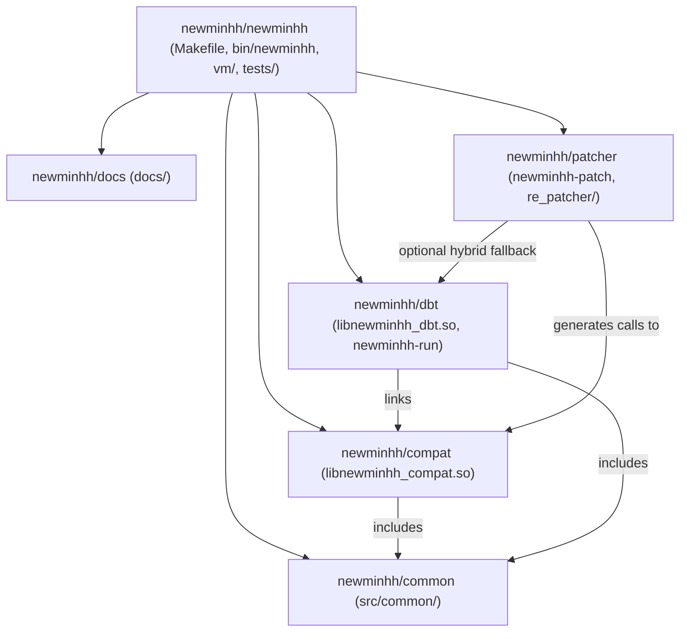

# newminhh (`新明` — "New Tomorrow")

> **Start Here:** This repository ([`newminhh/docs`](https://github.com/newminhh/docs)) is the primary entrypoint for visitors exploring the **`newminhh`** ecosystem.
>
> **Original Goal & Inspiration:** **"Better capability, less RAM usage guaranteed"** — inspired by Alex Alejandre's [*Janet on x32: 32-bit Pointers, 64-bit Speed, 25% Less RAM*](https://alexalejandre.com/programming/lisp/janet-for-the-x32-abi), which demonstrates how the Linux `x32` ABI combines 32-bit compact pointers (`__ILP32__`, cutting RAM usage by 20–50%) with full 64-bit Long Mode instruction sets and all 16 general-purpose registers (avoiding the ~50% speed penalty of legacy `-m32` IA-32 mode). **`newminhh`** eliminates the last barrier to running a pure `x32` userspace: executing legacy 32-bit `i386` executables and `.so` libraries directly against native `x32` system libraries in RAM without duplicating `i386` multilib libraries.
>
> **Meaning Behind the Name:** **`newminhh`** is named after **Tân Minh** commune (Hải Phòng, Vietnam), the author's home commune—translating to **"New Tomorrow"** in English and **新明** (*Xīn Míng*) in Simplified Chinese.

**`newminhh`** is a container-less **`i386` (`ELFCLASS32`, `EM_386`) compatibility system for `x32`-only (`ELFCLASS32`, `EM_X86_64`, ILP32) Linux**. It runs unmodified 32-bit x86 Linux executables and shared libraries (`.so`) directly on an `x86_64` kernel with an `x32`-only userspace (`ia32_emulation=0`, `syscall.x32=y`) and zero `:i386` packages—combining an offline static/hybrid ELF rewriter, an in-process Long Mode dynamic binary translator, and a shared `x32` ABI marshaling runtime that preserves kernel page-cache sharing across processes.

---

## Documentation Index

| Document | Description |
| :--- | :--- |
| [README.md](./README.md) | Project overview, split repository map, build/installation guide, and `bin/newminhh` CLI reference |
| [ARCHITECTURE.md](./ARCHITECTURE.md) | Deep technical reference for `common`, `compat`, `dbt`, and `patcher` (ABIs, registers, memory map, trampolines, syscalls, struct repacking, dynamic linking, static rewriting, and hybrid fallback) |
| [TESTING_AND_VM.md](./TESTING_AND_VM.md) | Guide to the Debian x32 libvirt/KVM VM scripts (`vm/`) and Parts 1–5 verification & `/proc/<pid>/smaps` benchmarking suites (`tests/`) |

---

## How `newminhh` Works (At a Glance)

In an x32-only Linux environment, the kernel executes in 64-bit Long Mode with `ia32_emulation=0`, and userspace uses the x32 ABI (`__x86_64__` + `__ILP32__`, 32-bit pointers/longs, SysV register calling convention, `/libx32/ld-linux-x32.so.2`). Legacy i386 binaries cannot run directly because:

1. **ISA differences**: Legacy i386 instructions such as 1-byte `inc`/`dec` (`0x40..0x4F`), `pusha`/`popa`, BCD opcodes (`aaa`, `daa`, etc.), and `int $0x80` / `sysenter` are invalid, repurposed as `REX` prefixes, or unsupported when IA-32 emulation is disabled.
2. **Calling convention mismatch**: i386 cdecl pushes all arguments onto a **4-byte-strided** stack and returns 64-bit integers in `EDX:EAX` and floating-point values on the x87 `ST(0)` stack; x32 SysV passes arguments in `%rdi..%r9` and `%xmm0..%xmm7` over an **8-byte** call/ret stack frame and returns floating-point values in `%xmm0`.
3. **Struct & syscall divergence**: Kernel syscall numbers (`x32` bit `0x40000000` + x86_64 numbers vs. i386 numbers) and ABI structs (`struct stat`, `struct stat64`, `_TIME_BITS=64` `stat`, `timespec`, `rlimit`, `pthread_mutex_t`) differ in layout and size.

`newminhh` solves these through two complementary execution engines backed by a shared x32 ABI runtime library:

- **Static / Hybrid Binary Patcher (`newminhh-patch`)**: Performs offline multi-tool reverse engineering (`elftools`, `capstone`, `angr`, `radare2`, optional `Ghidra`) to rewrite i386 `ELF32` binaries into native `EM_X86_64` x32 `ELF32` binaries linked against `libnewminhh_compat.so` and `/libx32/ld-linux-x32.so.2`. Rewritten code preserves a 4-byte cdecl stack stride on native `%rsp` via out-of-place code emission in `.text.newminhh`. Functions containing unresolved non-PLT indirect jumps can fall back selectively per-function to in-process DBT (`--hybrid-fallback` / `auto` mode).
- **In-Process Dynamic Binary Translator (`libnewminhh_dbt.so` / `newminhh-run`)**: Loads unpatched i386 executables and shared libraries directly into the x32 process with guest code mapped **`PROT_READ`-only (never `PROT_EXEC`)**, JIT-translating basic blocks on demand using Capstone, chaining direct edges, caching indirect branches in a lock-free 64K table, and trapping native-to-guest raw pointer calls via an async-signal-safe `SIGSEGV` NX-guard handler.

---

## Repository Split Map (`github.com/newminhh`)

The project is organized into six repositories under the `https://github.com/newminhh` GitHub organization:

| Repository | Local Path (Umbrella) | Primary Artifacts | Responsibility |
| :--- | :--- | :--- | :--- |
| [`newminhh/newminhh`](https://github.com/newminhh/newminhh) | `/` | `Makefile`, `bin/newminhh`, `vm/`, `tests/` | Umbrella orchestration, unified `newminhh` CLI, Debian x32 VM tooling, and Parts 1–5 verification/benchmarking suites |
| [`newminhh/common`](https://github.com/newminhh/common) | `src/common/` | `newminhh_abi.h`, `newminhh_log.h` | Shared C/assembly ABI offsets, `newminhh_cpu_t`, i386/x32 struct layouts, signature descriptors, integration hooks, and logging macros |
| [`newminhh/compat`](https://github.com/newminhh/compat) | `src/compat/` | `libnewminhh_compat.so` | x32 ABI runtime library: cdecl<->x32 assembly bridges, W^X trampoline pools, syscall translator, struct repacker, `dlopen`/`dlsym` router, and libc/libm/pthread wrappers |
| [`newminhh/dbt`](https://github.com/newminhh/dbt) | `src/dbt/` | `libnewminhh_dbt.so`, `newminhh-run` | In-process i386 ELF32 loader, Capstone x86-to-x86-64 JIT emitter, fast branch cache, edge chaining/unchaining, and NX-guard `SIGSEGV` callback dispatcher |
| [`newminhh/patcher`](https://github.com/newminhh/patcher) | `src/patcher/` | `newminhh-patch`, `re_patcher/` | Containerized (`re-env:latest`) static/hybrid binary analyzer, 4-byte-stride Long Mode rewriter, x32 GAS trampoline generator, and `EM_X86_64` ELF32 builder |
| [`newminhh/tests`](https://github.com/newminhh/tests) | `tests/` | `corpus/`, `part2/`–`part5/` | Parts 1–5 verification corpus (`C01`–`C11`, `S01`–`S03`, `N01`–`N09`), unit/regression suites, and `/proc/<pid>/smaps` benchmark harness |
| [`newminhh/vm_test_scripts`](https://github.com/newminhh/vm_test_scripts) | `vm/` | `domain.xml.in`, `vm-*.sh` | Debian `x32` `libvirt-qemu` provisioning, guest command execution, and `x32`-only isolation checks |
| [`newminhh/docs`](https://github.com/newminhh/docs) | `docs/` | `README.md`, `ARCHITECTURE.md`, `TESTING_AND_VM.md` | System-level, architectural, VM, and testing/benchmark documentation |
| [`newminhh/agent-notice`](https://github.com/newminhh/agent-notice) | *(archived)* | `PROJECT.md`, `.agents/` | Archived agent planning, milestone review, and Victory Audit artifacts |



---

## Prerequisites & Environment

`newminhh` uses a split **x86_64 host + Debian x32 guest VM** workflow (though native builds also work directly inside an x32 environment):

### Host (x86_64)
- **i386 corpus cross-compilation**: `gcc` with multilib (`gcc -m32`), `nasm`, `python3`, `make`, `rsync`, `tar`
- **VM management** (`vm/`): `virsh` (libvirt), `qemu-img`, `qemu-system-x86_64`, `ssh-keygen`, `curl`, `docker`, `socat` (plus optional `tio` or `screen` for serial console)
- **Static binary patching** (`src/patcher/`): `docker` with the **`re-env:latest`** image (contains Python `/opt/re-venv/bin/python3`, `elftools`, `capstone`, `angr`/`cle`, GNU `as`/`ld` with `--x32`/`elf32_x86_64`, `radare2`, and `/opt/ghidra/support/analyzeHeadless`)

### Target / Guest (Debian x32)
- Kernel compiled with **`CONFIG_X86_X32_ABI=y`** (or `CONFIG_X86_X32=y`) and booted with **`syscall.x32=y ia32_emulation=0`**
- Pure `x32` userspace (`dpkg --print-architecture` == `x32`, zero `:i386` packages)
- `gcc`, `g++`, `make`, `binutils`, `libc6-dev`, `linux-libc-dev`, `libcapstone-dev`, `python3`, `rsync`, `file`, `procps`

> [!IMPORTANT]
> **Kernel Requirements Notice (2026 Mainline Linux `x32` ABI Deprecation/Removal):**
> According to [Phoronix (*Linux x32 ABI in 2026*)](https://www.phoronix.com/news/Linux-x32-ABI-2026) and [LWN (*Reconsidering x32 — again*)](https://lwn.net/Articles/1074897/), mainline Linux moved in 2026 (around Linux 7.3+) to retire and remove the `x32` ABI (`CONFIG_X86_X32_ABI`, gating it behind `BROKEN` before removal). Because `newminhh` executes inside an `x32` userspace (`ELFCLASS32` `EM_X86_64`, using `0x40000000`-masked `x32` syscalls), the target/guest kernel **must** support the `x32` ABI:
> 1. **Kernel Version & Kconfig:** Run a kernel built with **`CONFIG_X86_X32_ABI=y`** (or **`CONFIG_X86_X32=y`**)—specifically **Linux 3.4 through 7.2** (or pre-removal 7.3 builds such as Debian's `linux-image-amd64`), an **LTS kernel** (e.g., Linux 6.1, 6.6, 6.12, or 6.18 LTS) compiled with `CONFIG_X86_X32_ABI=y`, or a custom newer kernel with the `x32` removal / `BROKEN` gate reverted.
> 2. **Boot Command-Line Flag (`syscall.x32=y`):** Distro kernels that compile `CONFIG_X86_X32_ABI=y` typically also set `CONFIG_X86_X32_DISABLED=y` by default. You **must** pass **`syscall.x32=y`** on the kernel command line (and **`ia32_emulation=0`** to verify pure `x32`-only execution without kernel IA-32 emulation).
> 3. **Verify Before Running:**
>    ```bash
>    zgrep -E 'CONFIG_X86_X32(_ABI)?=' /proc/config.gz /boot/config-$(uname -r) 2>/dev/null
>    grep 'syscall.x32=y' /proc/cmdline
>    ```

---

## Build & Installation

The top-level [`Makefile`](https://github.com/newminhh/newminhh/blob/main/Makefile) auto-detects whether it is running inside an x32 environment (`dpkg --print-architecture` == `x32` or `gcc` defines `__ILP32__`, setting `IN_X32=1`) or on the x86_64 host (`IN_X32=0`).

### Default Paths

| Variable | Default | Purpose |
| :--- | :--- | :--- |
| `PREFIX` | `/usr/local` | Base installation prefix |
| `LIBDIR` | `$(PREFIX)/lib/x86_64-linux-gnux32` | Install path for `libnewminhh_compat.so` and `libnewminhh_dbt.so` |
| `BINDIR` | `$(PREFIX)/bin` | Install path for `newminhh-run` and symlink `newminhh` |
| `DESTDIR` | *(empty)* | Optional staging root |
| `REMOTE_ROOT` | `/root/newminhh` | Sync destination inside the `newminhh-x32` VM |

### Building & Installing from the x86_64 Host

1. Provision and boot the Debian x32 VM (first time only):
   ```bash
   ./bin/newminhh vm up        # or: make vm-up (after vm/vm-provision.sh)
   ./bin/newminhh vm verify    # or: make vm-verify
   ```
2. Build the i386 test corpus on the host, sync sources to the VM, and compile native x32 runtime components (`libnewminhh_compat.so`, `libnewminhh_dbt.so`, `newminhh-run`, and x32 corpus baselines):
   ```bash
   make build
   # or via unified CLI:
   ./bin/newminhh build
   ```
3. Install binaries, libraries, and CLI symlink inside the VM (runs `ldconfig` when `DESTDIR` is empty):
   ```bash
   make install
   # or:
   ./bin/newminhh build --install
   ```

### Building & Installing Directly Inside an x32 Environment

When invoked where `IN_X32=1`:

```bash
make build      # builds src/compat, src/dbt, and tests/corpus x32 baselines
make install    # installs .so libraries, newminhh-run, and links bin/newminhh
make clean      # cleans compat, dbt, tests/corpus/build/x32, part2, part4
```

### Component-Level Builds

- **`compat`** (`src/compat/Makefile`):
  ```bash
  make -C src/compat all
  make -C src/compat install   # installs libnewminhh_compat.so into $(LIBDIR)
  ```
- **`dbt`** (`src/dbt/Makefile`):
  ```bash
  make -C src/dbt all
  make -C src/dbt install      # installs libnewminhh_dbt.so and newminhh-run
  ```
- **`patcher`** (`src/patcher/`): Pure Python + shell wrapper executed inside Docker (`re-env:latest`); requires no local compilation step.

---

## CLI Usage (`bin/newminhh`)

`bin/newminhh` provides a single entrypoint that automatically adapts to whether it is invoked on the x86_64 host or inside the Debian x32 guest.

### Environment Variables

| Variable | Default | Description |
| :--- | :--- | :--- |
| `NEWMINHH_ROOT` | Auto-detected from script path or `/root/newminhh` | Root directory of the `newminhh` repository |
| `NEWMINHH_REMOTE_ROOT` | `/root/newminhh` | Remote workspace path inside the x32 VM |
| `NEWMINHH_RE_IMAGE` | `re-env:latest` | Docker image used by `src/patcher/newminhh-patch` |
| `NEWMINHH_DEBUG` | `0` / unset | Set to non-zero (e.g. `1`) to enable `NM_LOG_INFO` diagnostics on `stderr` |

### Subcommands

#### `newminhh build [--install]`
Builds the runtime libraries (`libnewminhh_compat.so`, `libnewminhh_dbt.so`), `newminhh-run`, and test corpus. With `--install`, also installs them into `PREFIX`/`LIBDIR`/`BINDIR`.

#### `newminhh patch [patcher-args...] <input-i386-elf> -o <output-x32-elf>`
Wraps `src/patcher/newminhh-patch` via Docker (`re-env:latest`) to statically/hybrid-rewrite an i386 `ELF32` executable or shared object into an x32 `EM_X86_64` `ELF32`.

Options forwarded to `re_patcher.cli`:
- `-o, --output <path>` *(required)*: Output x32 ELF path (must be distinct from input).
- `--hybrid-fallback`: Always embed `.newminhh.orig` and link `libnewminhh_dbt.so` with `newminhh_dbt_enter_at` / `newminhh_dbt_exec_embedded` fallback stubs.
- `--no-hybrid-fallback`: Pure static mode; never links `libnewminhh_dbt.so`, failing loudly if any function is classified `REQUIRES_DBT_FALLBACK`.
- *(default)*: Auto mode; links `libnewminhh_dbt.so` only if one or more functions are classified `REQUIRES_DBT_FALLBACK`.
- `--use-r2`: Corroborate CFG/function recovery with radare2 (`aaa; aflj`); automatically enabled when `.symtab` is absent.
- `--use-ghidra`: Corroborate function recovery with `/opt/ghidra/support/analyzeHeadless`.
- `-v, --verbose`: Print summary diagnostics (`mode`, `funcs`, `fallback`, `size`).

Example:
```bash
newminhh patch tests/corpus/build/i386/cli_libc_pie -o /tmp/cli_libc_pie.x32
newminhh patch --no-hybrid-fallback tests/corpus/build/i386/libbasic_pic.so -o /tmp/libbasic_pic.so
```

#### `newminhh run [--so <path> <sym> [args...]] <elf> [args...]`
Executes an unpatched i386 executable or shared object via `newminhh-run`.
- Inside an x32 environment, executes `/usr/local/bin/newminhh-run` (or `src/dbt/newminhh-run`) directly.
- On the x86_64 host, automatically syncs the target file (or its parent directory if inside `NEWMINHH_ROOT`) into the `newminhh-x32` VM, runs `newminhh-run`, propagates the exit code, and cleans up temporary staging directories.

Examples:
```bash
newminhh run tests/corpus/build/i386/cli_libc_pie
newminhh run --so tests/corpus/build/i386/libplugin_stripped.so plugin_compute 7 5
```

#### `newminhh test [part1|part2|part3|part4|part5|all]`
Runs one or all verification suites (default: `all`, which invokes `make test` -> `test-part5`):
- `part1`: i386 & native x32 corpus build + baseline checks (`tests/corpus/run_part1_tests.sh`)
- `part2`: `libnewminhh_compat.so` ABI/bridge/syscall/struct/dl tests (`tests/part2/run_part2_tests.sh`)
- `part3`: Static & hybrid patcher tests on host + Docker + VM (`tests/part3/run_part3_tests.sh`)
- `part4`: Runtime DBT, `newminhh-run`, NX-guard, and multi-threaded stress tests (`tests/part4/run_part4_tests.sh`)
- `part5`: Clean build reproducibility, CLI checks, Parts 1–4 regression, and `/proc/<pid>/smaps` benchmarks (`tests/part5/run_part5_tests.sh`)

#### `newminhh bench [bench_smaps.py args...]`
Runs Part 5 `/proc/<pid>/smaps`, RSS/PSS memory sharing, and execution timing benchmarks inside `newminhh-x32` (supports `--daemons`, `--daemon-sec`, `--samples`, `--json`, etc.). On host, patches `bench_workload` first and orchestrates execution in the VM.

#### `newminhh vm <up|down|verify|exec|console> [args...]`
Host-only wrappers around `vm/vm-*.sh`:
- `newminhh vm up` — Boot VM and wait for DHCP + SSH readiness
- `newminhh vm down [--undefine] [--purge]` — Shut down VM cleanly (or destroy/undefine/purge)
- `newminhh vm verify` — Verify pure x32 VM configuration (zero `:i386` packages, `ia32_emulation=0`)
- `newminhh vm exec [-- command... | --sync local remote | --ip]` — Execute commands or sync directories over SSH
- `newminhh vm console [--tio | --screen | --pty | --endpoint]` — Attach to the VM's TCP serial console

---

## Referenced Sources & Architectural Influences

The following sources were actively referenced and adapted during the design and implementation of `newminhh`:

- **[Original Design Conversation (`share.google/aimode`)](https://share.google/aimode/7RVXOzvKN6OdZJ1Ft)** — Foundational architectural blueprint for container-less `i386`-on-`x32` execution via shared in-process `x32` ABI thunking, hybrid static ELF patching + compatibility library (`libnewminhh_compat.so`), bidirectional `.so` entry/exit wrappers, 64-bit struct alignment repacking (`stat`, `timespec`, `rlimit`), and runtime DBT fallback.
- **[Box86 (`ptitseb/box86`)](https://github.com/ptitseb/box86)** — Inspired the signature-driven `cdecl`-to-host calling convention marshaling tables (`newminhh_call_x32_sig` and `g_sym_table[]`), synthetic `INT3` (`0xCC 'N' 'M' <id>`) PLT/GOT exit-to-host bridge stubs in `libnewminhh_dbt.so`, and W^X reverse-callback trampoline pool design.
- **[Box64 (`ptitseb/box64`)](https://github.com/ptitseb/box64)** — Referenced for 64-bit Long Mode library wrapping and contrasted against `x32`'s unified `< 4 GiB` ILP32 pointer space.
- **[FEX-Emu (`FEX-Emu/FEX`)](https://github.com/FEX-Emu/FEX)** — Referenced for `i386`-on-`x86_64` Long Mode register allocation (`%r12d` = guest `ESP`, `%r14d` = guest `GS` base, `%r15` = `newminhh_cpu_t *` state pointer) and low-4GiB guest ELF loading (`newminhh-run` linked at `0x70000000`).
- **[Android Binary Translation / Berberis (`platform/frameworks/libs/binary_translation`)](https://android.googlesource.com/platform/frameworks/libs/binary_translation/)** — Referenced for two-tier TLS/ThreadState anchoring (`__thread` host `FS` TLS vs. guest `GS` base via `ARCH_SET_GS`), ABI trampolines, direct basic-block chaining, and fast 64K indirect-branch lookup caching.
- **[Alex Alejandre — *Janet on x32: 32-bit Pointers, 64-bit Speed, 25% Less RAM*](https://alexalejandre.com/programming/lisp/janet-for-the-x32-abi)** — Original inspiration demonstrating `x32` ILP32 memory savings with full 64-bit register performance.
- **[Phoronix — *Linux x32 ABI in 2026*](https://www.phoronix.com/news/Linux-x32-ABI-2026)** & **[LWN — *Reconsidering x32 — again*](https://lwn.net/Articles/1074897/)** — Reference for 2026 mainline kernel `CONFIG_X86_X32_ABI` deprecation and kernel requirements.

---

## Authors & Contributors

- **[shadichy](https://github.com/shadichy)** (`shadichy@blisslabs.org`) — Author & Project Lead
- **Antigravity (Google DeepMind)** — Contributor (multi-agent architecture, implementation, static/dynamic translation pipelines, verification suites, and documentation)
