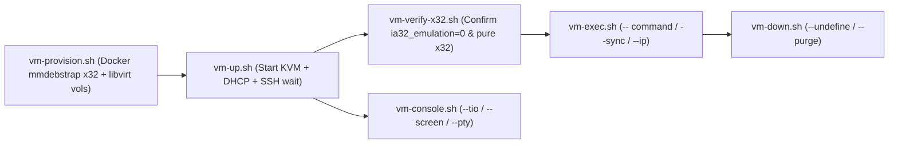

# Testing, VM Provisioning, and Benchmarking Guide

This guide covers the pure x32 Debian VM lifecycle tooling in `vm/` and the five-part verification and `/proc/<pid>/smaps` benchmarking infrastructure in `tests/`.

---

## 1. Debian x32-Only Libvirt/QEMU VM (`vm/`)

All target runtime verification runs inside a KVM-accelerated Debian `sid` (`debian-ports`) **pure x32** virtual machine whose kernel explicitly disables 32-bit IA-32 emulation.

### 1.1 VM Domain Definition (`vm/domain.xml.in`)

- **Machine / CPU**: `type='kvm'`, `machine='q35'`, `arch='x86_64'`, `<cpu mode='host-passthrough' check='none' migratable='on'/>`
- **Kernel command line**:
  ```text
  root=/dev/vda rw console=ttyS0,115200 syscall.x32=y ia32_emulation=0 mitigations=off
  ```
- **Devices**:
  - VirtIO block disk (`qcow2`, `discard='unmap'`, `dev='vda'`)
  - VirtIO network interface attached to libvirt network `@NET_NAME@`
  - TCP serial console bound to `@CONSOLE_HOST@:@CONSOLE_PORT@` (`127.0.0.1:4555` by default)
  - VirtIO guest agent UNIX channel (`org.qemu.guest_agent.0`)
  - VirtIO RNG backed by `/dev/urandom`

### 1.2 Environment Variables

| Variable | Default | Used By |
| :--- | :--- | :--- |
| `NEWMINHH_VM_NAME` | `newminhh-x32` | All `vm-*.sh` scripts |
| `NEWMINHH_VM_VCPUS` | `4` | `vm-provision.sh` |
| `NEWMINHH_VM_MEMORY_MIB` | `2048` | `vm-provision.sh` |
| `NEWMINHH_VM_DISK_SIZE` | `6G` | `vm-provision.sh` |
| `NEWMINHH_LIBVIRT_URI` | `qemu:///system` | All `vm-*.sh` scripts |
| `NEWMINHH_LIBVIRT_POOL` | `default` | `vm-provision.sh`, `vm-down.sh` |
| `NEWMINHH_LIBVIRT_NET` | `default` | `vm-provision.sh`, `vm-up.sh` |
| `NEWMINHH_VM_CONSOLE_HOST` | `127.0.0.1` | `vm-provision.sh` |
| `NEWMINHH_VM_CONSOLE_PORT` | `4555` | `vm-provision.sh` |
| `NEWMINHH_VM_WAIT_SECS` | `120` | `vm-up.sh` |
| `NEWMINHH_VM_SHUTDOWN_WAIT` | `30` | `vm-down.sh` |
| `NEWMINHH_VM_CONSOLE_PTY` | `/tmp/<VM_NAME>-console.pty` | `vm-console.sh` |

### 1.3 VM Management Scripts

| Script | CLI / Modes | Description |
| :--- | :--- | :--- |
| `vm/vm-provision.sh` | `[--force] [--update-xml]` | Rootless (no `sudo`) provisioning: generates ed25519 SSH keypair in `vm/.state/id_ed25519`, resolves the latest Debian `sid` standard `amd64` kernel (`linux-binary-*` + `linux-modules-*`, skipping `cloud`/`rt-`), bootstraps a `debian-ports` `x32` rootfs via Docker `debian:sid-slim` + `mmdebstrap --architectures=x32 --variant=minbase`, builds `initramfs` (`virtio_blk`, `virtio_pci`, `virtio_net`, `ext4`), installs toolchain + `libcapstone-dev` (if available), configures autologin/SSH/permissive dev sysctls (`vm.mmap_min_addr=0`, `kernel.yama.ptrace_scope=0`, etc.), converts to `qcow2`, uploads volumes to libvirt pool, and defines `vm/.state/domain.xml`. `--force` rebuilds from scratch; `--update-xml` re-renders `domain.xml` without touching disk. |
| `vm/vm-up.sh` | *(no flags)* | Starts `LIBVIRT_NET` if inactive, starts/resumes the domain, waits for DHCP lease (`virsh domifaddr --source lease` / `arp`), caches `vm/.state/guest_ip`, and polls SSH readiness. |
| `vm/vm-exec.sh` | `-- <cmd...>`, `--sync <local> <remote>`, `--ip` | Resolves guest IP, runs commands over passwordless ed25519 SSH, or incrementally syncs directories with `rsync -az`. |
| `vm/vm-console.sh` | `[--tio \| --screen \| --pty \| --endpoint]` | Bridges `tcp://127.0.0.1:4555` to a local PTY via `socat` and attaches with `tio` (default if present), `screen` (`115200`), or exposes a foreground PTY bridge (`--pty`). |
| `vm/vm-down.sh` | `[--undefine] [--purge]` | Requests SSH `sync && systemctl poweroff`, sends ACPI `virsh shutdown`, falls back to `virsh destroy` after timeout. `--undefine` removes domain definition; `--purge` also deletes libvirt volumes and `vm/.state/`. |
| `vm/vm-verify-x32.sh` | *(no flags)* | Verifies inside the running VM that `uname -m == x86_64`, `/proc/cmdline` has `syscall.x32=y` and `ia32_emulation=0`, `dpkg --print-architecture == x32`, foreign architectures are empty, zero `:i386` packages or `libc6-i386` exist, `/lib/ld-linux.so.2` and `/lib32/libc.so.6` are absent, `/libx32/ld-linux-x32.so.2` is present, `/bin/ls` is `ELF32` + `X86-64`, and compiles/runs a `gcc` smoke test checking `__x86_64__ && __ILP32__`, `sizeof(void *) == 4`, `sizeof(long) == 4`, `sizeof(long long) == 8`. |



---

## 2. Verification & Benchmark Suites (`tests/`)

All five test parts can be driven from the top-level `Makefile` (`make test-part1`..`make test-part5`, `make test`, `make bench`) or via `./bin/newminhh test <part1|part2|part3|part4|part5|all>`.

### 2.1 Part 1 — Corpus Build & Baseline Checks (`tests/corpus/`)

`tests/corpus/Makefile` cross-compiles all i386 (`-m32`) test fixtures on the host and native x32 baselines inside the VM:

#### Positive CLI Fixtures (`C01`–`C11`)

| Source | Built Targets | Coverage |
| :--- | :--- | :--- |
| `src/cli_libc.c` | `cli_libc_pie`, `cli_libc_nopie` | `getenv`, `calloc`/`realloc`/`malloc`/`free`/`memcpy`, function pointers, `snprintf`, POSIX `open`/`write`/`lseek`/`read`/`close`/`unlink` |
| `src/cli_switch_jumptable.c` | `cli_switch_jumptable_pie`, `cli_switch_jumptable_nopie` | Dense 24-case `switch` jump tables (PIE PIC-relative and non-PIE absolute) |
| `src/cli_pic_thunks.c` + `cli_pic_thunks_helper.c` | `cli_pic_thunks` | Cross-TU `__x86.get_pc_thunk.*`, global arrays, `__thread` TLS counters |
| `src/cli_structs_abi.c` | `cli_structs_abi`, `cli_structs_abi64` | `stat`/`fstat`/`lstat` (`32-bit` and `-D_FILE_OFFSET_BITS=64`), `clock_gettime`, `nanosleep`, `getrlimit`/`setrlimit`, 64-bit field alignment |
| `src/cli_callbacks.c` | `cli_callbacks` | `qsort`, `bsearch`, `pthread_create`/`pthread_join` with `pthread_mutex_lock`, LIFO `atexit` handlers |
| `src/cli_syscall_int80.c` | `cli_syscall_int80` | Raw inline `int $0x80` (`getpid`, `uname`, `mmap2`, `munmap`, `clock_gettime`, `write`, `exit_group`) |
| `src/cli_syscall_sysenter.c` + `_i386.asm` | `cli_syscall_sysenter` | Raw NASM `sysenter` syscall sequence (`getpid`, `write`, `exit_group`) |
| `src/cli_init_fini.c` | `cli_init_fini` | Prioritized `__attribute__((constructor(101/102)))` & `destructor(101/102)` ordering |
| `src/cli_dlopen_client.c` | `cli_dlopen_client` | Runtime `dlopen`/`dlsym`/`dlerror`/`dlclose` against `libm.so.6` (`sqrt`, `cos`) and `./libplugin_stripped.so` (`plugin_compute`) |
| `src/cli_stripped.c` | `cli_stripped` | `--strip-all` stripped binary combining switch jump table, `fstat`, `clock_gettime`, `getrlimit`, `qsort`, `pthread`, `atexit` |

#### Shared Objects (`S01`–`S03`), Host Driver & Workload

- `libbasic_pic.so` (`src/libbasic_pic.c`): PIC shared library with switch statement, `malloc`/`snprintf`, and persistent state counter.
- `liblifecycle_abi.so` (`src/liblifecycle_abi.c`): Tests `.init_array` constructor, `.fini_array` destructor (`NEWMINHH_FINI_MARKER`), `int $0x80` `getpid`, `stat`, `clock_gettime`/`getrlimit`, `qsort` internal callback, host-to-guest callback registration (`lifecycle_register_cb`/`trigger_cb`), and guest-exported callback pointer (`lifecycle_get_guest_cb`).
- `libplugin_stripped.so` (`src/libplugin_stripped.c`): `--strip-unneeded` plugin shared library exporting `plugin_init_val`, `plugin_compute`, `plugin_name`.
- `x32_so_host_driver` (`src/x32_so_host_driver.c`, compiled natively on x32): Drives `S01`–`S03` + `N09` either via host `dlopen`/`dlsym`/`dlclose` (for patched `.so`s and native baselines) or via `libnewminhh_dbt.so` (`--dbt` / `NEWMINHH_USE_DBT=1`) against unpatched i386 `.so`s.
- `bench_workload` (`src/bench_workload.c`): Supports `--compute [iters]`, `--libc-heavy [iters]`, and `--daemon <sec> [marker]`.

#### Negative Fixtures (`N01`–`N09`)

Generated by `tests/corpus/make_negatives.py` (N01–N08) and `src/neg_dlsym_missing.c` (N09):

| ID | Fixture | Defect / Condition |
| :--- | :--- | :--- |
| `N01` | `bad_trunc_ehdr.elf` | Truncated 32-byte ELF header |
| `N02` | `bad_magic.bin` | 256-byte non-ELF file |
| `N03` | `bad_arch_arm.elf` | `ELFCLASS32` with `e_machine = EM_ARM (40)` |
| `N04` | `bad_class64_i386.elf` | `EI_CLASS = ELFCLASS64 (2)` with `e_machine = EM_386 (3)` |
| `N05` | `bad_phdr_oob.elf` | `PT_LOAD` `p_offset` and `p_filesz` beyond EOF |
| `N06` | `bad_corrupt_dyn.elf` | `PT_DYNAMIC` `DT_STRTAB` (`0xDEADBEEF`) / `DT_SYMTAB` (`0xDEADC0DE`) out of bounds |
| `N07` | `bad_priv_insn.elf` | Privileged/trap opcodes (`hlt`, `ud2`, `in al, dx`) |
| `N08` | `bad_bcd_insn.elf` | Long-Mode invalid BCD opcodes (`aaa`, `daa`) |
| `N09` | `neg_dlsym_missing` | Missing symbol lookup (`dlsym("libc.so.6", "newminhh_nonexistent_sym")`) |

`tests/corpus/run_part1_tests.sh` verifies ELF headers, runs all native x32 baselines, confirms `N09` exits non-zero, and confirms un-translated i386 binaries fail to execute natively on the x32-only VM.

---

### 2.2 Part 2 — `libnewminhh_compat.so` ABI & Wrapper Suite (`tests/part2/`)

`tests/part2/run_part2_tests.sh` builds and installs `libnewminhh_compat.so` inside `newminhh-x32`, compiles `test_compat.c` + `test_compat_asm.S` into `test_compat`, and asserts all 6 sub-suites pass with structured error logs on negative paths:

1. `test_outgoing_marshaling`: `newminhh_call_x32_sig`, `newminhh_call_x32_cdecl` (`EDX:EAX` 64-bit and x87 `ST(0)` float/double returns), >6 GPR and >8 XMM stack spills, and 16B outgoing pool trampolines (`strlen`, `strtoull`, `sqrt`, `sqrtf`).
2. `test_incoming_bridge`: `newminhh_in_bridge`, `newminhh_wrap_so_export`, `newminhh_wrap_init_array_fn`, `newminhh_wrap_fini_array_fn`, and `%esp % 16 == 12` alignment check at cdecl entry (`asm_cdecl_check_align`).
3. `test_callbacks_and_trampoline_pool`: `compat_qsort`/`compat_bsearch`, `compat_pthread_create` with `set_thread_area` `GS` propagation and 24-byte `pthread_mutex_t`, LIFO `compat_atexit`/`__cxa_atexit`/`__cxa_finalize`, 8-arg pooled trampoline, mock DBT guest invoker delegation, and `compat_signal`.
4. `test_syscalls`: `getpid`, `pipe2`/`write`/`read`/`close`, `mmap2` (`pgoffset << 12`)/`munmap`, `uname`, `stat64`, `clock_gettime`/`clock_gettime64`, `ugetrlimit`, `set_thread_area` -> `arch_prctl(ARCH_SET_GS)` + `%gs:` reads, `brk` hook isolation, and `-ENOSYS` + error log on syscall `9999`.
5. `test_struct_repacking`: `stat32`, unaligned `stat64`, `stat64_t64`, `EOVERFLOW` on 64-bit sizes/inodes/timestamps (`timespec32`), `rlimit32` `RLIM_INFINITY` mapping, and `NULL` pointer checks.
6. `test_dl_and_wrappers`: `compat_dlopen`/`dlsym`/`dlclose` on `libc.so.6` and `libm.so.6`, `NM_RTLD_CDECL` + `compat_dlsym_cdecl` outgoing bridges (`snprintf`, `strtoull`, `sqrt`), `format_from_cdecl_words` (`compat_snprintf_cdecl`, `compat_vsnprintf`, `compat_vsprintf`), `gnu_get_libc_version` missing-wrapper rejection, forged handle/double-close checks, and mock DBT `nm_dl_backend_t` delegation.

---

### 2.3 Part 3 — Static & Hybrid Patcher Suite (`tests/part3/`)

`tests/part3/run_part3_tests.sh` runs across host, Docker `re-env:latest`, and `newminhh-x32`:

- **Stage 1**: Patches all 18 i386 corpus ELFs in both `--no-hybrid-fallback` and `--hybrid-fallback` modes; checks `ELF32`, `Advanced Micro Devices X86-64`, `DT_RELA`, `libnewminhh_compat.so` in `DT_NEEDED`, presence/absence of `libnewminhh_dbt.so`, and `/libx32/ld-linux-x32.so.2` `PT_INTERP`.
- **Stage 1b**: Compiles `fb_fallback_test.c` (PIE & non-PIE, containing an unresolved `jmp *%eax` exercising `%esi`/`%edi` callee-saved preservation across DBT fallback) and `mem_ijmp.c` (`jmp *(%eax)`). Asserts `--no-hybrid-fallback` rejects `REQUIRES_DBT_FALLBACK`, while `auto` and `--hybrid-fallback` emit working binaries linking `libnewminhh_dbt.so`.
- **Stage 2**: Runs `--use-r2` on `cli_stripped` and `--use-ghidra` on `libplugin_stripped.so`.
- **Stages 3–4**: Syncs patched binaries to the VM and runs every executable, `NEWMINHH_TEST_ENV` check, `cli_dlopen_client`, `bench_workload`, `neg_dlsym_missing`, `x32_so_host_driver`, `fb_*`, `cli_stripped_r2`, and `libplugin_ghidra.so` directly under the x32 kernel and `ld-linux-x32.so.2`, requiring exact stdout and exit-code parity with native x32 baselines.
- **Stage 5**: Runs `newminhh-patch` against `N01`–`N08`, verifying non-zero exit, `[newminhh:patcher] ERROR:` stderr output, and zero leftover output files.

---

### 2.4 Part 4 — In-Process DBT & Stress Suite (`tests/part4/`)

`tests/part4/run_part4_tests.sh` builds `libnewminhh_dbt.so` and `newminhh-run` with zero compiler warnings inside the VM (verifying `newminhh-run` is linked at `0x70000000`) and runs:

1. All 13 unpatched i386 CLI fixtures + `NEWMINHH_TEST_ENV` + `bench_workload` under `newminhh-run`, diffing against x32 baselines.
2. `newminhh-run --so ./libplugin_stripped.so plugin_compute 7 5` (expects exit code `47`).
3. `x32_so_host_driver --dbt` driving unpatched `libbasic_pic.so`, `liblifecycle_abi.so`, `libplugin_stripped.so`, and `N09`.
4. `N01`–`N09` negative tests confirming non-zero exit and stderr diagnostics.
5. `test_part4_api.c`: `newminhh_dbt_enter_at` on `PROT_READ`-only raw i386 machine code (`0x40 inc eax`, `0x48 dec eax`) and `newminhh_dbt_exec_embedded` on an in-memory ELF blob.
6. `test_part4_mt_stress.c` (6 concurrency & edge-case stress tests):
   - `test_sigsegv_sigign_in_child`: Preserves pre-existing `SIG_IGN` for non-guest `SIGSEGV`.
   - `test_fast_cache_collision_mt`: 8 threads x 20,000 iterations hitting deliberate `g_dbt_fast_cache` hash collisions alongside concurrent `dbt_invalidate_cache_range`.
   - `test_direct_edge_unchaining`: Modifies Block B in place, calls `dbt_invalidate_cache_range`, and confirms Block A's patched direct edge unchains cleanly.
   - `test_concurrent_brk_dl_sigsegv`: 8 threads x 200 iterations concurrently invoking raw `PROT_READ` NX-guard callbacks, i386 `brk` (`45`) syscalls, and `newminhh_dbt_dlopen`/`dlsym`/`dlclose`.
   - `test_exec_embedded_eexist_diag`: Forces `0x08048000` collision and verifies `EEXIST` rejection.
   - `test_fs_moffs_rejected`: Confirms `0x64` (`%fs:`) prefix on `0xA0..0xA3` returns `NM_ERR_INSN`.

---

### 2.5 Part 5 — Reproducibility, CLI, and `/proc/<pid>/smaps` Benchmarks (`tests/part5/`)

`tests/part5/run_part5_tests.sh` (invoked by `make test` or `newminhh test part5`) runs:
- **Stage 1**: Clean `make clean && make build` (failing on any compiler `warning:`) + `make install` + VM file checks.
- **Stage 2**: Comprehensive `bin/newminhh` CLI positive and error-path tests.
- **Stage 3**: Full `vm-verify-x32.sh` and Parts 1–4 regression (skippable with `NEWMINHH_SKIP_PARTS_1_TO_4=1`).
- **Stage 4**: Patches `bench_workload` in `auto` and `--hybrid-fallback` modes and executes `tests/part5/bench_smaps.py` (plus a `--json` validation pass).

#### What `bench_smaps.py` Measures and Enforces

`bench_smaps.py` compares up to four execution modes inside `newminhh-x32`:
`native_x32`, `patched_compat` (`newminhh-patch`), optional `patched_hybrid` (`--hybrid-fallback`), and `dbt_runtime` (`newminhh-run`).

1. **Concurrent Daemon `/proc/<pid>/smaps` & `/proc/<pid>/maps` Audit** (default `--daemons 4`, `--daemon-sec 4`):
   - **Zero i386 Libraries**: Fails if any VMA maps `/lib/i386-linux-gnu`, `/usr/lib/i386-linux-gnu`, `/lib32/`, `/usr/lib32/`, `ld-linux.so.2`, or `ld-linux.so.3`.
   - **Single Shared Inode & Zero Private Dirty Pages**: Inspects `libc.so.6` (must come from `x86_64-linux-gnux32` or `/libx32`), `libnewminhh_compat.so`, and `libnewminhh_dbt.so`:
     - All `K` daemon processes (and all modes for `libc.so.6` / `libnewminhh_compat.so`) must map the **exact same non-zero inode**.
     - File-backed `r--p` (`Anonymous == 0`) and `r-xp` VMAs must have `Private_Dirty == 0` and `Shared_Clean > 0` (tiny `<= 64 kB` GNU RELRO `r--p` anonymous pages at non-zero file offset are isolated cleanly).
   - **Fleet RAM Savings**: Verifies `sum(PSS) < sum(RSS)` across the `K` concurrent processes and reports `(sum(RSS) - sum(PSS)) / sum(RSS) * 100%`.
2. **Execution Timing Benchmarks** (default `--samples 5`):
   - `compute`: `bench_workload --compute 5000000` (CPU-bound switch/arithmetic loop, deterministic checksum verified against `native_x32`)
   - `libc_heavy`: `bench_workload --libc-heavy 20000` (`malloc`/`qsort`/`snprintf`/`clock_gettime`/`stat`/`free` loop)
   - `cold_start`: `bench_workload --compute 1000` (process startup + dynamic linking latency)

Running benchmarks directly:
```bash
# From host (auto-patches bench_workload and runs inside newminhh-x32):
./bin/newminhh bench --daemons 4 --samples 5
./bin/newminhh bench --samples 3 --json
```
